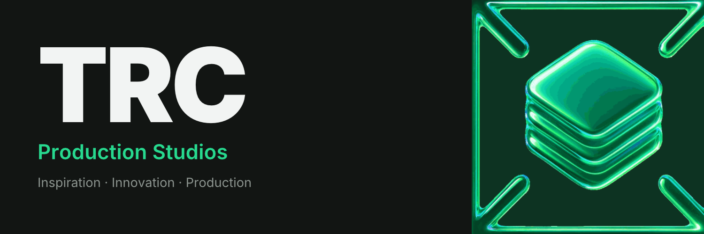
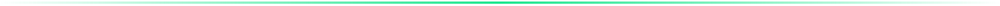

 
 

 
 

##  About us

TRC Production Studios is a small game and development studio from Switzerland. We build games, tools and web projects, and show how they come to life on our channels.

Our motto: **Inspiration · Innovation · Production**

##  What we do

<table>
  <tr>
    <td width="33%" valign="top">
       
      <b>Games</b> 
      Original game projects and systems, including for Roblox and Minecraft.
    </td>
    <td width="33%" valign="top">
       
      <b>Web and Tools</b> 
      Websites, dashboards and hosting infrastructure.
    </td>
    <td width="33%" valign="top">
       
      <b>Content</b> 
      Videos, streams and behind-the-scenes looks.
    </td>
  </tr>
</table>

##  Projects

| Repository | Description |
|---|---|
| [trc-web](https://github.com/TRC-Production-Studios/trc-web) | The TRC Production Studios website |
| [BR-Website](https://github.com/TRC-Production-Studios/BR-Website) | Prototype of the BR-Website |

Each repository has its own README with more details.

##  Tech Stack

HTML · JavaScript · Lua · Python · Docker

##  Contact

 &nbsp;[trc-production-studios.com](https://trc-production-studios.com) 
 &nbsp;[info@trc-production-studios.com](mailto:info@trc-production-studios.com)

 

TRC Production Studios · Switzerland

